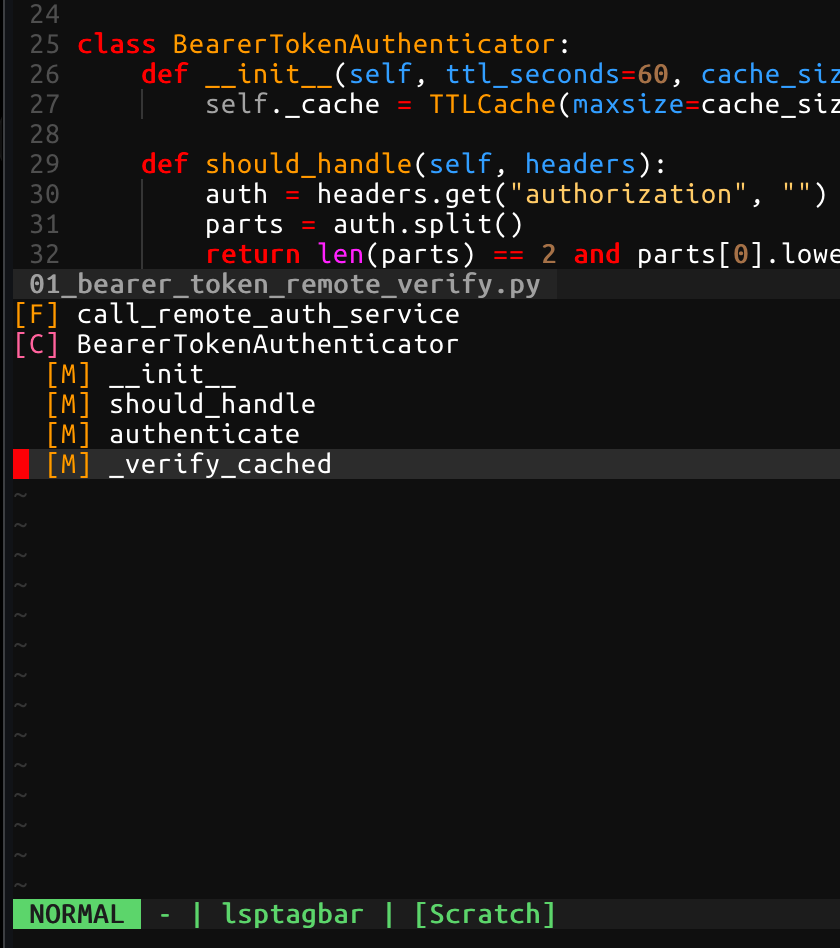

# LSP Symbol Bar

A bottom (or right) bar with a file tree of your project and the current
buffer's classes, functions, and methods — symbols built entirely from
`textDocument/documentSymbol`. No ctags, no external process, no other
plugin dependency.

- A NERDTree-style [file tree](#file-tree) is the default view, rooted at
  the current file's git checkout, with the current file revealed; dirty,
  git-ignored, symlinked and executable entries are colored and tagged.

- Nested by real hierarchy when the server provides it, or by
  `containerName` when it only returns a flat list (e.g. pylsp).
- Filtered to a small set of useful kinds; imports and other bare
  references to a name are dropped, not just definitions.
- The bar opens with the cursor already on the symbol you're in, and keeps
  following it as you move — no need to hunt for where you are.
- Markdown (and other markup filetypes) get a section outline from their
  `#` headings instead — no LSP needed, code fences ignored.
- Anything the server misses can be matched with your own treesitter
  queries and merged into the tree (see [Custom entries](#custom-entries)).
- Mark any line yourself with `@@ some text` in a comment or docstring and
  it shows up as `[@] some text` (see [Markers](#markers)).
- Git changes show as `[+]` / `[~]` / `[-]` entries, one per hunk (see
  [Git changes](#git-changes)), and the `changed` view is the file tree cut
  down to the files that differ from the git base.
- `]]` / `[[` step through the views: files > changed > symbols > markers >
  changes.

## Requirements

- Neovim >= 0.10
- An LSP client attached to the buffer that supports
  `textDocument/documentSymbol` — except for `heading_filetypes`, which need
  nothing at all

## Install

```lua
-- lazy.nvim
{ 'solomonxie/nvim-lsp-tagbar' }
```
```lua
-- packer.nvim
use 'solomonxie/nvim-lsp-tagbar'
```
```vim
" vim-plug
Plug 'solomonxie/nvim-lsp-tagbar'
```

No key is mapped for you: map `:LspTagbarToggle` or
`require('nvim-lsp-tagbar').find` yourself, or set `keymap`. Call `setup()`
only to change the defaults:

```lua
require('nvim-lsp-tagbar').setup({
  keymap = 'ft',   -- a key that toggles the bar; none by default
  height = 20,
  -- or a right sidebar that previews each symbol as you move over it:
  -- position = 'right', width = 40, auto_preview = true,
})
```

## Usage

- `:LspTagbarToggle` (or your `keymap`) — toggle the bar
- Inside the bar, in every view:
  - `]]` / `[[` — next / previous view, wrapping around: files (the
    [file tree](#file-tree), the default, see `default_view`) > changed (the tree with only changed files) >
    symbols > [markers](#markers) (flat) > [changes](#git-changes) (this
    buffer's git hunks, flat). The view is kept for the session; the winbar
    shows which one you're in
  - `?` — show / hide a quick help above the tree: these keys, the
    current view, the marker patterns for this filetype, and where the
    entries come from (which LSP servers, treesitter queries, markers)
  - `!` — lock the bar open, `!` again to unlock; `[locked]` leads the title
    while it's on (see [File tree](#file-tree))
  - `q` / `<Esc>` — close the bar; with `auto_close` (the default) it also
    closes as soon as focus moves to another window, unless locked
  - `:bn`, `:bp`, `:e` and the like are refused in the bar (`winfixbuf`), so
    it never shows another buffer
- In the file tree (`files` and `changed` views):
  - `<CR>` / `o` / double click — open the file, or open / close the folder
  - `go` — preview the file in the source window, keeping the bar
  - `O` — open the folder and every folder under it (git-ignored and
    symlinked folders are skipped, and it stops at a cap for huge trees);
    on a file, same as `o`
  - `x` — close the folder the cursor is in
  - `s` / `i` — open the file in a vertical split / split
  - `p` — jump to the parent folder's line
  - `R` — re-read the tree; `I` — show / hide dotfiles
  - `m` — file menu: `a`dd (a trailing `/` makes a folder), `m`ove /
    rename, `c`opy, `d`elete (asks first), `r`eveal in Finder (macOS), or
    `x` run it by type: `.sh` with bash, `.py` with python3, `.js` with node
    and so on in a terminal split from the file's folder; `.html`, `.pdf`,
    images and other documents with `open` (`xdg-open` off macOS); any other
    file with an execute bit as is. The table is `require('nvim-lsp-tagbar.files').runners`.
    Open buffers follow a move
  - `Y` — copy the entry's full path to the clipboard and `"` register
  - `T` — types `:ChangeGitDiffBase ` on the command line for you to finish
    (a ref, or nothing for your setup's default); the bar repaints on its
    `User GitDiffBaseChanged`
  - `gn` / `gp` — jump to the next / previous changed file (vs the git
    base), opening the folders on the way; wraps around
- In the symbol views:
  - `<CR>` / double click — jump to the symbol and close the bar
  - `j` / `k` — with `auto_preview`, the source window follows to each symbol
  - `p` — jump to the enclosing symbol's line, within the bar
  - `o` — show / hide who calls this symbol, inline under it (LSP call
    hierarchy). A chain of single callers unfolds all the way up; press `o`
    on any caller line to open its callers. `<CR>` on a caller jumps to the
    call. Callers in tests are counted but not listed. For a Python method,
    callers that go through a same-named method elsewhere (e.g. a Protocol)
    are included, marked `(via file:line)`.
- `require('nvim-lsp-tagbar').find()` — for your own mapping, like
  NERDTree's find: opens the bar (or jumps into it) with the current file
  revealed, e.g. `vim.keymap.set('n', 'ff', require('nvim-lsp-tagbar').find)`
- `require('nvim-lsp-tagbar').back()` — from the bar, back to the window it
  was opened from; the bar stays open. Map it in the bar's buffer, e.g. on
  `FileType lsptagbar`, to make the same key go both ways
- `:LspTagbarDebug` — print internal state (buf/win validity, jump count)
  for troubleshooting, with the bar open and cursor inside a symbol

## Config defaults

```lua
{
  keymap = nil,          -- a key to toggle the bar, e.g. 'ft'
  position = 'bottom',   -- or 'left' / 'right'
  height = 20,           -- for 'bottom'
  width = 40,            -- for 'left' / 'right'
  auto_preview = false,
  auto_close = true,     -- close the bar when focus leaves it
  default_view = 'files', -- or 'changed', 'symbols', 'markers', 'changes'
  follow = true,         -- with auto_close off, follow the buffer you switch to
  files = {
    show_hidden = false, -- dotfiles; `I` toggles
    ignore = { '%.pyc$', '%.sw[po]$', '^__pycache__$', '^node_modules$' },
    close_on_open = true, -- opening a file from the tree closes the bar
    refresh_ms = 30000,  -- re-read the tree while shown; 0 disables the timer
    git = true,          -- color by git state, grey out ignored entries
    arrows = { closed = '▸', open = '▾' },
    path = nil,          -- function(path) -> path, before a buffer is revealed
  },
  callers_include_tests = false,
  callers_test_patterns = { '/tests?/', '/test_[^/]*$', '_test%.[^/]*$', '/conftest%.py$', '%.spec%.', '%.test%.' },
  heading_filetypes = { 'markdown', 'rmd', 'quarto', 'vimwiki' },
  heading_label = '[H%d]',
  markers = { ['*'] = { '@@%s*(.-)%s*$' } },
  marker_label = '[@]',
  git_hunks = true,
  git_base = nil,        -- nil: g:git_diff_base if set, else 'HEAD'
  git_hunk_labels = { add = '[+]', change = '[~]', delete = '[-]' },
  queries = {},
  kinds = {
    [5] = '[C]',   -- Class
    [6] = '[M]',   -- Method
    [9] = '[M]',   -- Constructor
    [12] = '[F]',  -- Function
    [14] = '[K]',  -- Constant
    [23] = '[S]',  -- Struct
  },
}
```

`heading_filetypes` are outlined from their `#` headings (nested by level,
`%d` in `heading_label` is that level) and never query an LSP; set it to `{}`
to always use LSP symbols.

`kinds` maps an [LSP `SymbolKind`](https://microsoft.github.io/language-server-protocol/specifications/lsp/3.17/specification/#symbolKind)
number to the label shown in the bar; a kind not listed here is dropped.
The shipped `syntax/lsptagbar.vim` highlights the default `[C]`/`[M]`/`[F]`/`[K]`/`[S]`/`[H1-6]`
labels specifically — overriding `kinds` loses that highlighting unless you
also adjust the syntax file.

## Custom entries

Servers disagree on what deserves a symbol — `lua_ls` names an anonymous
callback after the call it's passed to, `emmylua_ls` omits it entirely. Add
`queries` to match those yourself:

```lua
require('nvim-lsp-tagbar').setup({
  queries = {
    lua = {
      { label = '[U]', query = [[
        ((function_call
           name: (_) @fn
           (#eq? @fn "vim.api.nvim_create_user_command")
           arguments: (arguments (string content: (string_content) @name))) @scope)
      ]] },
    },
  },
})
```

```
[U] LspTagbarToggle
[U] LspTagbarDebug
```

- `@name` (required) — the text shown, and where `<CR>` jumps to.
- `@scope` (optional) — the entry's range, so the bar highlights it while
  the cursor is anywhere inside; defaults to `@name`'s own node.

Matches are merged into the server's tree under the deepest symbol whose
range contains them, then siblings are re-sorted by line — so a match inside
a function nests under it, and one at file scope sits in document order
among the real symbols. A query that fails to parse is reported once via
`vim.notify` and skipped.

`label` is yours to choose and won't be highlighted by the shipped syntax
file unless you add a rule for it.

Cost is confined to filetypes you configure: anything absent from `queries`
returns after two table lookups and touches no parser, so a 4500-line Python
file opens the bar in 0.2 ms either way. A configured filetype matches once
per edit, memoised across the two or three renders a single open triggers —
7.8 ms for a 6000-line Lua file with treesitter already running, 4.3 ms for a
typical 300-line one. Nothing runs on cursor movement.

## Markers

Put `@@` and some text anywhere on a line, usually in a comment or
docstring, and the `markers` view lists them in file order:

```python
class Exporter:
    def run(self):
        # @@ retry loop starts here
        ...

def load():
    """
    @@ TODO: drop the v1 format
    """
```

```
[@] retry loop starts here
[@] TODO: drop the v1 format
```

It's a plain line scan, so it works in any filetype, with or without an LSP
or a treesitter parser. Change the marker, per filetype or for all of them
(`'*'`), with Lua patterns whose first capture is the text shown:

```lua
require('nvim-lsp-tagbar').setup({
  markers = {
    ['*'] = { '@@%s*(.-)%s*$' },          -- the default
    python = { '<!!%s*(.-)%s*>' },        -- `# <!!setup db>` in Python instead
    diff = {},                            -- none in this filetype
  },
  marker_label = '[@]',
})
```

`markers` replaces the default table as a whole, so keep `'*'` in it if you
still want `@@` in other filetypes, or set `markers = {}` to turn markers off.
The scan runs once per edit, memoised like the queries above.

Press `]]` / `[[` in the bar to step through the views: files, changed, symbols
(with your [treesitter queries](#custom-entries) merged in), markers and
changes. The current view's name is shown in the bar's winbar, and the bar
reopens in the last view used until nvim exits.

## File tree

The `files` view lists folders first, then files, by name. It's rooted at
the git checkout of the file you opened the bar from — the nearest folder
up its path with a `.git` (a git worktree counts), else the cwd — and
opens with that file revealed and the cursor on it. Symlinked folders are
never resolved: a file opened through one shows under it, as if it were a
plain folder. A file outside the cwd's checkout that a symlink in it points
to (the file itself or a folder holding it) also stays in the cwd's tree,
shown through that link, even when it was opened by its real path (fzf, an
LSP jump, `gF`). Otherwise the tree moves to the file's own checkout.
Folders you open stay open for the session.

The `changed` view is the same tree showing only the files that differ from
the git base, plus untracked ones, with every folder holding one opened,
colored the same way. It says `No changed files` when there are none. All
the file tree keys work in it.

```
▾ lua/
  ▾ nvim-lsp-tagbar/
      files.lua
      init.lua
▸ tests/
  build.sh (exc)
  tmp/ (sym) (ign)
```

Names are colored by git state against the same base as the
[git changes](#git-changes) (`git_base`, else `g:git_diff_base`, else
`HEAD`):

| Entry | Color | Tag after the name | Highlight group |
|---|---|---|---|
| changed or untracked file | bold green | | `lsptagbarGitDirtyFile` |
| folder holding one | green | | `lsptagbarGitDirtyDir` |
| git-ignored | grey | `(ign)`, not repeated inside an ignored folder | `lsptagbarGitIgnored` |
| symlink / hard-linked file | cyan | `(sym)` / `(hard)` | `lsptagbarFileLink` |
| executable file | purple | `(exc)` | `lsptagbarFileExec` |

Git state wins the name's color; the link / executable color only shows on
clean entries. The groups are defined as defaults, so a colorscheme or a
`:highlight` of your own overrides them; `lsptagbarFileArrow` colors the
`▸` / `▾` arrows. `git = false` turns the git part off.

While the tree is shown it's re-read every `refresh_ms` (and git is
re-asked at most every 3 seconds), skipped while you're moving in it (the
last 2 seconds), outside normal mode, or while nvim is in the background.
It's also re-read right away when nvim gets focus back (e.g. after a
`git checkout` in another terminal), after `:!` or the built-in terminal,
and when you save a file. An unchanged tree is never redrawn.
`doautocmd User GitDiffBaseChanged` repaints it right away. `R` re-reads it
by hand.

`!` in the bar locks it open: opening a file or symbol from it, or moving
to another window, no longer closes it, and `[locked]` shows at the start of
its title. `!` again unlocks it. The lock lasts for the nvim session.

With the bar locked, or `auto_close = false`, and `follow` (the
default), it follows the buffer you switch to: the tree reveals that file
(only when it's under the root, so the root never jumps), and the symbol
views show that buffer's symbols. Add `close_on_open = false` for a
NERDTree-like sidebar:

```lua
require('nvim-lsp-tagbar').setup({
  position = 'right',
  width = 50,
  auto_close = false,
  files = { close_on_open = false },
})
```

`files.path` maps a buffer's path before it's looked up in the tree, e.g.
to show a file opened by its real path through a symlink in the checkout.

## Git changes

In the `changes` view, each hunk between the buffer and a git base is an
entry, in file order, named after its first non-blank line:

```
[~] rows = read_rows(path, strict=True)
[-] 3 lines removed
[+] def save(rows):
```

The diff is done in the plugin (`git show` + `vim.diff`), so no git-signs
plugin is needed, and unsaved edits count. The base is `git_base` (a ref,
or a function returning one); left unset it reads `g:git_diff_base`, else
`HEAD`. Set that variable from your config to share one base with other
git views, and fire `doautocmd User GitDiffBaseChanged` after changing it
so an open bar refreshes.
A file git doesn't have at the base is one big `[+]`. Set
`git_hunks = false` to turn it off.

## Design

The bar's layout, labels, empty states and config surface are drawn in
[`docs/uiux/bar.md`](docs/uiux/bar.md).

## Screenshot


