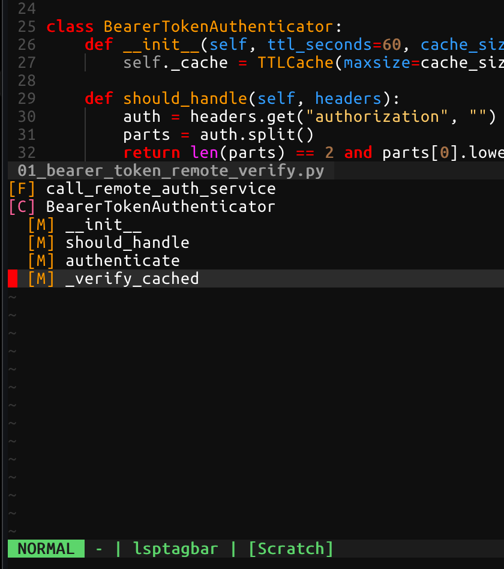

# LSP Symbol Bar

A bottom (or right) bar of the current buffer's classes, functions, and methods —
built entirely from `textDocument/documentSymbol`. No ctags, no external
process, no other plugin dependency.

- Nested by real hierarchy when the server provides it, or by
  `containerName` when it only returns a flat list (e.g. pylsp).
- Filtered to a small set of useful kinds; imports and other bare
  references to a name are dropped, not just definitions.
- The bar opens with the cursor already on the symbol you're in, and keeps
  following it as you move — no need to hunt for where you are.
- Markdown (and other markup filetypes) get a section outline from their
  `#` headings instead — no LSP needed, code fences ignored.
- Anything the server misses can be matched with your own treesitter
  queries and merged into the tree (see [Custom entries](#custom-entries)).

## Requirements

- Neovim >= 0.8
- An LSP client attached to the buffer that supports
  `textDocument/documentSymbol` — except for `heading_filetypes`, which need
  nothing at all

## Install

```lua
-- lazy.nvim
{ 'solomonxie/nvim-lsp-tagbar' }
```
```lua
-- packer.nvim
use 'solomonxie/nvim-lsp-tagbar'
```
```vim
" vim-plug
Plug 'solomonxie/nvim-lsp-tagbar'
```

Works out of the box — `ft` toggles the bar. Call `setup()` only to change
the defaults:

```lua
require('nvim-lsp-tagbar').setup({
  keymap = 'ft',   -- false to disable the default mapping
  height = 20,
  -- or a right sidebar that previews each symbol as you move over it:
  -- position = 'right', width = 40, auto_preview = true,
})
```

## Usage

- `ft` (or `:LspTagbarToggle`) — toggle the bar
- Inside the bar:
  - `<CR>` — jump to the symbol and close the bar
  - `j` / `k` — with `auto_preview`, the source window follows to each symbol
  - `p` — jump to the enclosing symbol's line, within the bar
  - `o` — show / hide who calls this symbol, inline under it (LSP call
    hierarchy). A chain of single callers unfolds all the way up; press `o`
    on any caller line to open its callers. `<CR>` on a caller jumps to the
    call. Callers in tests are counted but not listed. For a Python method,
    callers that go through a same-named method elsewhere (e.g. a Protocol)
    are included, marked `(via file:line)`.
  - `q` / `<Esc>` — close the bar
- `:LspTagbarDebug` — print internal state (buf/win validity, jump count)
  for troubleshooting, with the bar open and cursor inside a symbol

## Config defaults

```lua
{
  keymap = 'ft',
  position = 'bottom',   -- or 'right'
  height = 20,           -- for 'bottom'
  width = 40,            -- for 'right'
  auto_preview = false,
  callers_include_tests = false,
  callers_test_patterns = { '/tests?/', '/test_[^/]*$', '_test%.[^/]*$', '/conftest%.py$', '%.spec%.', '%.test%.' },
  heading_filetypes = { 'markdown', 'rmd', 'quarto', 'vimwiki' },
  heading_label = '[H%d]',
  queries = {},
  kinds = {
    [5] = '[C]',   -- Class
    [6] = '[M]',   -- Method
    [9] = '[M]',   -- Constructor
    [12] = '[F]',  -- Function
    [14] = '[K]',  -- Constant
    [23] = '[S]',  -- Struct
  },
}
```

`heading_filetypes` are outlined from their `#` headings (nested by level,
`%d` in `heading_label` is that level) and never query an LSP; set it to `{}`
to always use LSP symbols.

`kinds` maps an [LSP `SymbolKind`](https://microsoft.github.io/language-server-protocol/specifications/lsp/3.17/specification/#symbolKind)
number to the label shown in the bar; a kind not listed here is dropped.
The shipped `syntax/lsptagbar.vim` highlights the default `[C]`/`[M]`/`[F]`/`[K]`/`[S]`/`[H1-6]`
labels specifically — overriding `kinds` loses that highlighting unless you
also adjust the syntax file.

## Custom entries

Servers disagree on what deserves a symbol — `lua_ls` names an anonymous
callback after the call it's passed to, `emmylua_ls` omits it entirely. Add
`queries` to match those yourself:

```lua
require('nvim-lsp-tagbar').setup({
  queries = {
    lua = {
      { label = '[U]', query = [[
        ((function_call
           name: (_) @fn
           (#eq? @fn "vim.api.nvim_create_user_command")
           arguments: (arguments (string content: (string_content) @name))) @scope)
      ]] },
    },
  },
})
```

```
[U] LspTagbarToggle
[U] LspTagbarDebug
```

- `@name` (required) — the text shown, and where `<CR>` jumps to.
- `@scope` (optional) — the entry's range, so the bar highlights it while
  the cursor is anywhere inside; defaults to `@name`'s own node.

Matches are merged into the server's tree under the deepest symbol whose
range contains them, then siblings are re-sorted by line — so a match inside
a function nests under it, and one at file scope sits in document order
among the real symbols. A query that fails to parse is reported once via
`vim.notify` and skipped.

`label` is yours to choose and won't be highlighted by the shipped syntax
file unless you add a rule for it.

Cost is confined to filetypes you configure: anything absent from `queries`
returns after two table lookups and touches no parser, so a 4500-line Python
file opens the bar in 0.2 ms either way. A configured filetype matches once
per edit, memoised across the two or three renders a single open triggers —
7.8 ms for a 6000-line Lua file with treesitter already running, 4.3 ms for a
typical 300-line one. Nothing runs on cursor movement.

## Screenshot


